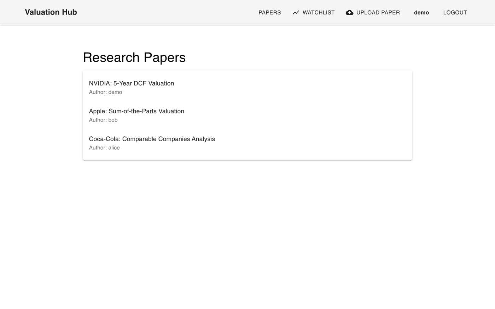
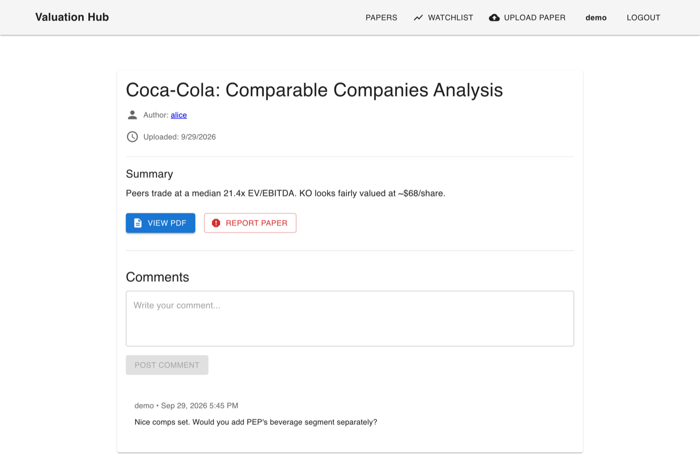
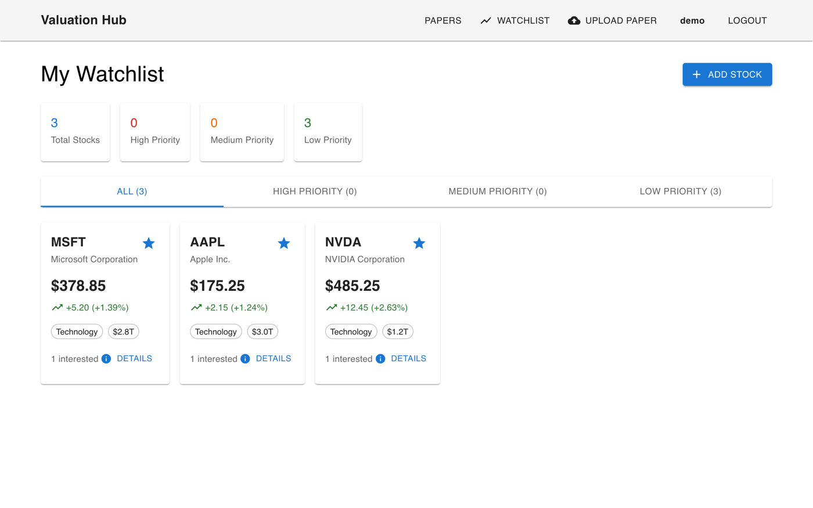
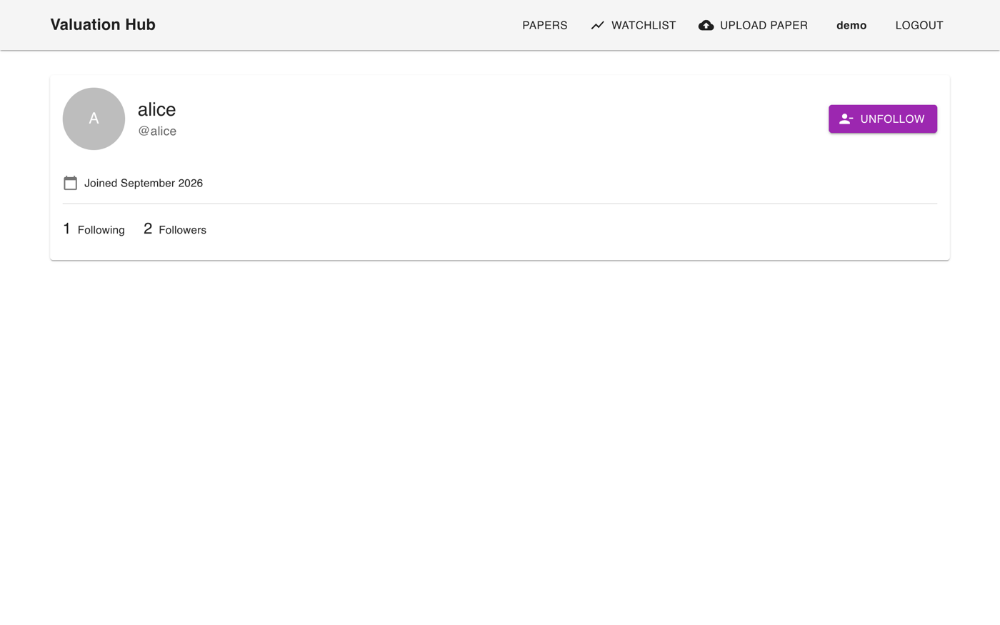

# Valuation Hub

[](https://github.com/spark318/Valuation-Web-Organization/actions/workflows/ci.yml)

A full-stack web app where investors share equity research: upload valuation write-ups as PDFs, discuss them in comments, follow other analysts, and track stocks on a personal watchlist.

**Stack:** Django REST Framework · React 19 · Material UI · JWT auth · AWS S3 · PostgreSQL / SQLite



| Paper and discussion | Watchlist | Analyst profile |
|:---:|:---:|:---:|
|  |  |  |

## Features

- **Research papers:** upload a PDF with a title and summary; others can read, download, and comment. Any logged-in user can report a paper, which hides it until a moderator restores it from the Django admin.
- **Watchlist:** search stocks by ticker or company name, add them with a priority and notes, and see a summary by priority. Price alerts are supported in the API.
- **Social:** user profiles with follower/following counts, follow and unfollow, and a user search endpoint.
- **Auth:** registration and login with JWT access/refresh tokens. The frontend refreshes expired access tokens automatically.

## Run it locally

You need Python 3.10+ and Node 18+. No database server or AWS account is required: with no configuration, the backend uses SQLite and stores uploads in `./media`.

```bash
git clone https://github.com/spark318/Valuation-Web-Organization.git
cd Valuation-Web-Organization

# Backend (http://localhost:8000)
python -m venv .venv && source .venv/bin/activate
pip install -r requirements.txt
python manage.py migrate
python manage.py seed_demo      # sample stocks + demo users
python manage.py runserver

# Frontend (http://localhost:3000), in a second terminal
cd frontend
npm install
npm start
```

Log in as `demo` / `demo-pass-123`. The `alice` and `bob` accounts use the same password.

To use PostgreSQL or S3, copy `.env.example` to `.env` and fill in the relevant values.

## Architecture

```
React SPA (frontend/)                     Django REST API
─────────────────────                     ─────────────────────────────────────────
services/apiClient.js  ── JWT in header ─▶  /api/token/, /api/auth/   djoser + SimpleJWT
  axios instance with                      /api/papers/              papers app ──▶ S3 or local media
  auto token refresh                       /api/papers/{id}/comments/
context/AuthContext.js                     /api/stocks/              stocks app
components/ (MUI)                          /api/users/               users app (custom User, Follow)
```

The backend is split into three Django apps:

| App | Models | Responsibility |
|---|---|---|
| `users` | `User` (custom), `Follow` | Profiles, follow graph, user search |
| `papers` | `Paper`, `Comment` | PDF uploads, comments (nested routes via `drf-nested-routers`), reporting |
| `stocks` | `Stock`, `UserStock`, `StockAlert` | Stock search, per-user watchlists and alerts |

## Design notes

- **Object-level permissions.** Anyone can read papers and comments, but only the author can edit or delete them (`papers/permissions.py`). Watchlists and alerts are scoped to the requesting user in `get_queryset`, so another user's entries return 404 rather than 403, which doesn't reveal that they exist.
- **Private emails.** User endpoints are public so profiles can be shared, but the serializer strips `email` unless you're looking at your own account.
- **Storage chosen by configuration.** When `AWS_STORAGE_BUCKET_NAME` is set, PDFs go to a private S3 bucket and the API returns pre-signed URLs that expire after an hour. Otherwise they're stored on disk, so the project runs with zero setup.
- **Server-side validation.** Uploads must be PDFs, the `is_hidden` moderation flag can't be set by clients, and stock IDs are validated before creating watchlist entries or alerts.
- **Twelve-factor config.** Secrets, database, allowed hosts, and CORS origins all come from environment variables (`.env.example`).

## Tests and CI

```bash
python manage.py test
```

25 API tests cover authentication, author-only edit/delete, email privacy, the follow system, watchlist isolation between users, input validation, and moderation. GitHub Actions runs them on every push, checks for missing migrations, and builds the frontend with lint warnings treated as errors.

## Project history

Built in May 2025 by [Andrew Park](https://github.com/spark318) with [njj09026](https://github.com/njj09026). The planning notes in [`docs/PLANNING.md`](docs/PLANNING.md) show how features were scoped before implementation. It was later hardened for public release: author-only permissions, email privacy, environment-based configuration, a local-storage fallback, a working token refresh, and the test suite.

Stock prices in the demo data are a static snapshot, not live market data.
